<div align="center">

<!-- ==========================================
     ANIMATED GITHUB CONTRIBUTION HEATMAP
     Auto-refreshed daily via GitHub Actions
     ========================================== -->

<h3><code>darshan@github ~ $ ./contributions.sh</code></h3>



<br>
<br>

<!-- ==========================================
     TERMINAL PROFILE: ASCII PORTRAIT + NEOFETCH
     Self-typing monochrome ASCII SVG + Info Card
     ========================================== -->

<h3><code>darshan@github ~ $ whoami</code></h3>

<table>
  <tr>
    <td valign="top">
      
    </td>
    <td valign="top">
      
    </td>
  </tr>
</table>

<br>
<br>

<!-- ==========================================
     DEVELOPER STACK & CONNECT
     ========================================== -->

<h3><code>darshan@github ~ $ ./links.sh</code></h3>

<p><b>Full-Stack & Mobile Developer · AI & 3D Web Enthusiast</b></p>

[](https://github.com/darshansatbhai)
[](mailto:darshansatbhai38@gmail.com)
[](https://github.com/darshansatbhai?tab=repositories)

<br>

```bash
echo "Built with Python, SMIL & CSS animations — zero third-party tracking services."
```

</div>
